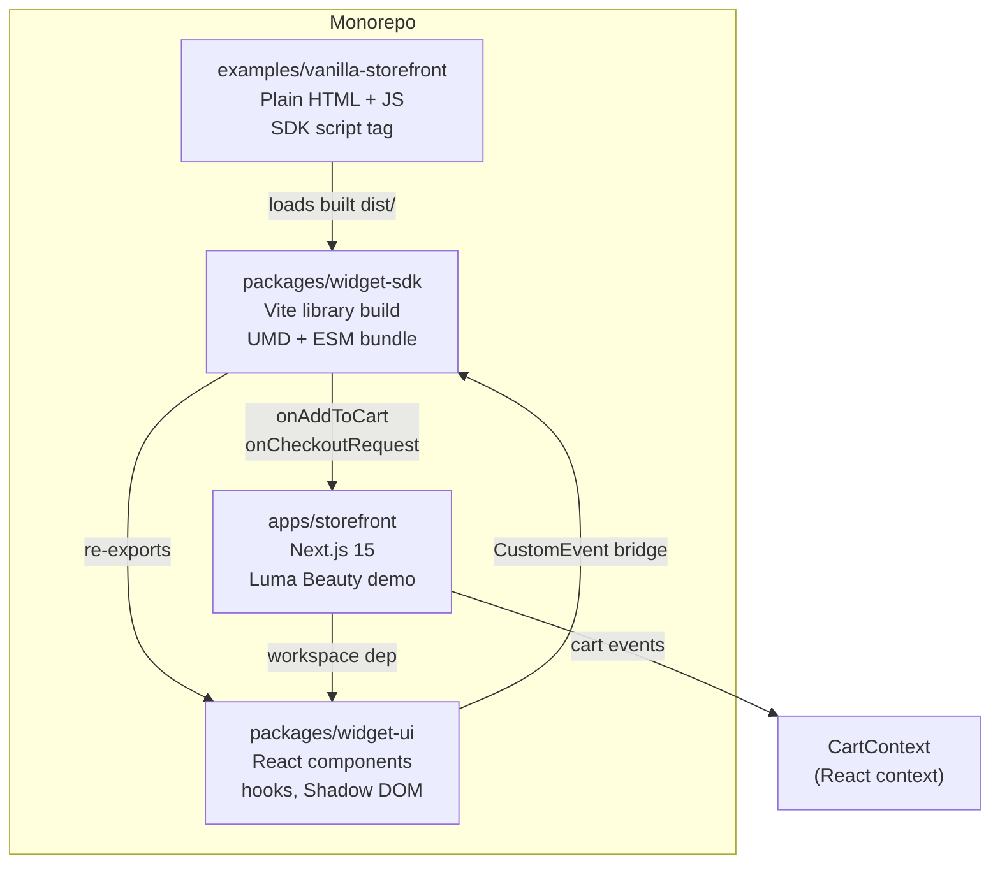

# GlowGuide -- Project Walkthrough

A portfolio engineering project: an embeddable skin-discovery and product-recommendation widget SDK for beauty ecommerce retailers, demonstrated through a fictional storefront called Luma Beauty.

## Live demo

**Storefront:** https://glowguide-eta.vercel.app/

Open the storefront, browse products, and click the **GlowGuide** floating button in the bottom-right corner to start the guided skin-discovery flow.

## What this project demonstrates

| Capability | Detail |
|------------|--------|
| Embeddable SDK design | Vanilla JS UMD bundle + ESM module, `window.GlowGuide` global, typed event system |
| React component library | Shadow DOM isolation, `useGlowGuideSDK` hook, SSR-safe `'use client'` patterns |
| Next.js App Router | Server and client components, route segments, dynamic product pages, cart context |
| TypeScript | Strict types throughout: SDK config, event payloads, React props, service interfaces |
| Testing | Vitest unit tests, React Testing Library component tests, Playwright E2E browser tests |
| Accessibility | Keyboard navigation, focus trapping, `aria-live` regions, `prefers-reduced-motion` |
| Developer experience | Integration playground, event log inspector, snippet generator, full Markdown docs |

---

## Architecture



**Key design decisions:**

- **Shadow DOM isolation** -- widget CSS is scoped inside a shadow root so it never conflicts with the host storefront's styles and vice versa
- **Dual event channels** -- every widget event fires both through `sdk.on(...)` (typed SDK emitter) and `window.dispatchEvent(new CustomEvent(...))` (decoupled DOM bridge), so any host integration pattern works
- **Mock analysis** -- the skin-analysis service is a typed deterministic mock; results are clearly labelled as illustrative, making the project safe for portfolio and demo use without real AI or medical infrastructure
- **No backend required** -- camera frames are processed entirely in-browser and never transmitted; no server, database, or API keys needed

---

## Local setup

```bash
git clone https://github.com/EmmanuelEyo/glowguide.git
cd glowguide
pnpm install
pnpm dev          # http://localhost:3000
```

For the full command reference see [`CONTRIBUTING.md`](../CONTRIBUTING.md).

---

## Feature tour

### 1. Luma Beauty storefront

Navigate to http://localhost:3000. The storefront is a fully functional Next.js ecommerce demo with:

- **Homepage** -- hero section, featured products, brand story
- **Product catalogue** (`/products`) -- filterable product grid with quick-add to cart
- **Product detail** (`/products/[id]`) -- image carousel placeholder, description, add-to-cart
- **Cart drawer** -- persistent sidebar cart, quantity management, remove items

### 2. GlowGuide widget flow

Click the **GlowGuide** floating launcher (bottom-right). The widget guides you through:

1. **Welcome** -- introduction to the guided experience
2. **Consent** -- explicit data consent before camera access
3. **Camera / upload** -- live camera capture or file upload fallback
4. **Processing** -- animated analysis step (respects `prefers-reduced-motion`)
5. **Skin insight report** -- illustrative sample observations, clearly labelled as simulated
6. **Product recommendations** -- matched products from the Luma Beauty catalogue
7. **Add to cart** -- recommended products are added directly to the storefront cart

### 3. SDK embedding modes

- **Floating mode** (default) -- launcher button in a configurable corner
- **Inline mode** -- widget mounted inside any container element via `mode: 'inline'`
- See [`examples/vanilla-storefront/`](../examples/vanilla-storefront/) for a plain HTML/JS integration

### 4. Developer playground

Navigate to http://localhost:3000/playground. The playground lets you:

- Configure SDK options (store ID, brand name, primary colour, theme, launcher position, mode)
- Preview the widget live with the selected config
- Inspect the event log in real time
- Copy a ready-to-use integration code snippet

### 5. Developer documentation

Full docs at [`docs/README.md`](./README.md):

- [Installation](./installation.md) -- CDN, npm, browser requirements
- [Configuration](./configuration.md) -- every `GlowGuideConfig` option with defaults
- [API reference](./api.md) -- all 14 `GlowGuideInstance` methods
- [Events](./events.md) -- all 13 SDK events with typed payloads
- [Vanilla JS guide](./guides/vanilla-js.md) and [React / Next.js guide](./guides/react-nextjs.md)
- [Troubleshooting](./troubleshooting.md)

---

## Testing approach

| Layer | Runner | Coverage |
|-------|--------|----------|
| SDK unit tests | Vitest | EventEmitter, GlowGuideSDK lifecycle, config validation |
| React component tests | Vitest + React Testing Library | WelcomeStep, ConsentStep, SkinReportStep, WidgetProgress |
| Hook tests | Vitest + jsdom | `useGlowGuideSDK`, `useReducedMotion` |
| Service tests | Vitest | Recommendation engine, mock analysis service |
| E2E browser tests | Playwright | Full shopper journey, cart integration, widget embedding, camera failure |

Run all tests: `pnpm test` (unit) and `pnpm test:e2e` (browser).

---

## Deployment

The storefront is deployed to Vercel. Configuration is in [`vercel.json`](../vercel.json) at the monorepo root.

**To deploy your own fork:**

1. Push the repository to GitHub
2. Go to [vercel.com/new](https://vercel.com/new) and import the repository
3. Vercel auto-detects the config from `vercel.json` -- no manual settings needed
4. Click **Deploy**

The first deploy takes about 2 minutes. Update the live demo URL at the top of this file once it completes.

**Build commands (for reference):**

| Step | Command |
|------|---------|
| Install | `pnpm install` |
| Build storefront | `pnpm build:storefront` |
| Build SDK | `pnpm --filter @glowguide/widget-sdk build` |

> **HTTPS required.** The browser `getUserMedia` API only works on secure origins. Vercel provides HTTPS automatically on all deployments.
